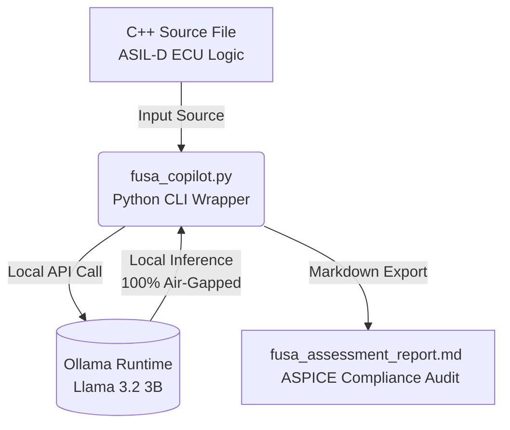

<<<<<<< HEAD
# auto-fusa-llm
Local Edge Functional Safety &amp; ASPICE Copilot for Automotive C++
=======
<div align="center">

# Auto-FuSa-LLM 🚗⚡
### Local Edge Functional Safety & ASPICE Copilot for Automotive C++


*Ensuring safety-critical automotive compliance at the edge—100% offline, private, and air-gapped.*

</div>

---

## 📖 Table of Contents
- [The Automotive Edge Thesis](#-the-automotive-edge-thesis)
- [System Architecture](#-system-architecture)
- [Repository Structure](#-repository-structure)
- [Hardware & Software Setup](#-hardware--software-setup)
- [Usage Guide](#-usage-guide)
- [Sample Safety Assessment Report](#-sample-safety-assessment-report)
- [License](#-license)

---

## 🎯 The Automotive Edge Thesis: IP & Data Privacy

In automotive software engineering, exposing proprietary vehicle source code and low-level ECU logic to public cloud LLM APIs (such as OpenAI or Anthropic) introduces severe compliance, intellectual property, and cybersecurity risks. 

**Auto-FuSa-LLM** solves the data privacy dilemma by executing local inference via **Ollama and Llama 3.2** directly on edge hardware (Raspberry Pi). This air-gapped architecture ensures that zero lines of proprietary source code or functional safety metrics ever leave the physical development environment.

---

## 🏗️ System Architecture



---

## 📂 Repository Structure

```text
auto-fusa-llm/
├── fusa_copilot.py                    # Main CLI static analysis runner
├── case1_memory_leaks_unsafe.cpp      # Non-compliant dynamic allocation
├── case1_memory_leaks_safe.cpp        # Compliant static/stack allocation
├── case2_input_validation_unsafe.cpp  # Non-compliant unvalidated bus signals
├── case2_input_validation_safe.cpp    # Compliant boundary-checked signals
├── case3_pointer_arithmetic_unsafe.cpp# Non-compliant out-of-bounds pointer walk
└── case3_pointer_arithmetic_safe.cpp  # Compliant array/iterator bounds check
```

---

## 🛠️ Hardware & Software Setup

> [!NOTE]
> This setup guide assumes **Raspberry Pi OS (64-bit)** running on a Raspberry Pi 4 (8GB RAM) or Raspberry Pi 5.

### 1. Install Ollama & Pull Llama 3.2
Ollama manages lightweight open-source models natively on edge hardware. Open your terminal and execute:

```bash
# Install Ollama on Linux
curl -fsSL https://ollama.com/install.sh | sh

# Pull the 3-Billion parameter model optimized for edge devices
ollama run llama3.2
```

### 2. Clone and Configure the Repository

```bash
sudo apt update && sudo apt install -y python3-pip python3-dev python3-venv

# Clone repository
cd ~
git clone https://github.com/your-username/auto-fusa-llm.git
cd auto-fusa-llm

# Initialize and activate virtual environment
python3 -m venv venv
source venv/bin/activate

# Upgrade pip and install required Python packages
pip install --upgrade pip
pip install ollama
```

---

## 🚀 Usage Guide

Ensure your virtual environment is active (`source venv/bin/activate`), then execute the auditor against a target C++ file:

```bash
python fusa_copilot.py case1_memory_leaks_unsafe.cpp
```

> [!IMPORTANT]
> **Inference Performance:** Because evaluation is processed entirely via the Raspberry Pi’s CPU, local execution takes approximately **15 to 45 seconds** per file. Upon completion, the tool outputs the report directly to the terminal and serializes it to `fusa_assessment_report.md`.

---

## 📋 Sample Safety Analysis Report

An evaluation of non-compliant safety-critical code yields structured diagnostics mapped to automotive standards:

### Executive Summary
The analyzed C++ source code contains safety-critical issues that compromise system reliability and robustness. The code violates **MISRA C++:2023** guidelines and **ISO 26262 (ASIL-D)** principles, posing significant risks to system determinism and memory safety.

### Key Violations Identified

| Standard / Rule | Line | Violation Description | Risk Analysis | Recommended Remediation |
| :--- | :---: | :--- | :--- | :--- |
| **MISRA C++:2023 (S-12.1.1)** | 5 | Unbounded raw pointer usage | Potential null-pointer dereference resulting in system crash | Transition to smart pointers (`std::unique_ptr<int> calculatedValue(new int(value * 2));`) |
| **MISRA C++:2023 (S-12.1.2)** | 7 | Dynamic memory allocation (`malloc`/`new`) | Memory fragmentation, leaks, or exhaustion over long runtimes | Use stack allocation or deterministic `std::unique_ptr` management |
| **ISO 26262 (ASIL-D)** | 5 | Unvalidated bus inputs | System failure or undefined behavior from null/invalid pointers | Implement boundary checks (`if (rawData == nullptr) { /* handle null */ }`) |
| **ISO 26262 (ASIL-D)** | 7 | Non-deterministic execution | Violates real-time deadlines and execution guarantees | Refactor to deterministic, bounded operations (`int value = value * 2;`) |

---

## 📄 License
Distributed under the MIT License. See `LICENSE` for details.
>>>>>>> 37b5978 (feat: initial commit of Auto-FuSa-LLM repository)
